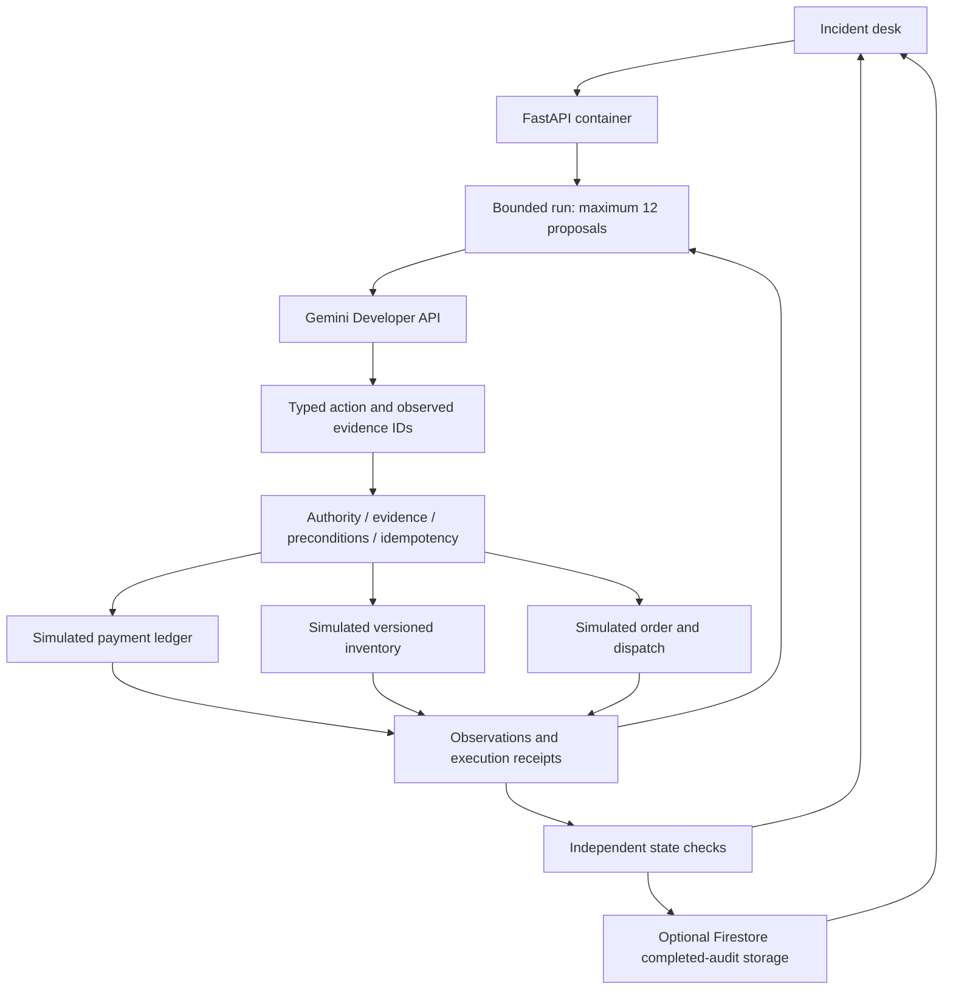

# Architecture and review notes

## Interface

The UI is component-based React, compiled with Vite. A separately loaded Three.js module renders procedural glass service objects around a customer-intent core. Native scrolling and pointer dragging rotate the scene. Selecting a service updates its accessible description. The illustrative opening is separate from the actual recovery state shown in the desk.

Rendering pauses outside the viewport and in hidden tabs. Reduced-motion preferences and explicit motion controls use a static SVG alternative, which also serves as the no-WebGL fallback. Fonts and geometry are local. Hashed bundles use immutable caching and text responses support gzip. The production Docker build compiles the frontend in a Node stage and serves it from FastAPI.

## Trust boundaries

- Model output is a proposal, never an authorization. JSON is validated by Pydantic before use.
- Customer mandates come from reviewed fixtures or explicit, validated incident-lab permission fields. Uploaded JSON is synthetic data and does not grant authority over real systems. Service observations are treated as data, not prompt instructions.
- Mutation citations must refer to observed evidence from each required service. Reservation versions must match the latest observation and current service version.
- All writes occur in a bounded simulator. There is no arbitrary shell, network tool, card charge or shipment operation.
- Execution receipts bind an idempotency key to the typed payload. Duplicate requests cannot reserve/refund twice. Conflicting reuse is rejected.
- Final checks are computed from state independently of model explanations, including stock conservation and agreement between order and reservation.
- Unknown payment and irreversible dispatch cause escalation. A timeout never automatically authorizes another charge.

## Google AI integration

For live runs the controller first gathers the three mandatory service observations. `app/agent.py` then calls the provider with a JSON schema for a single next-step proposal. The runner returns tool evidence in the next request, creating a bounded observation/action loop. It uses Gemini's structured output rather than a framework-managed autonomous agent. Provider-specific errors are classified without publishing raw error bodies, tokens or keys.

Gemini Developer API is the only live AI integration, with a server-only key. The other planner is transparent no-AI rehearsal. Optional Firestore persistence uses a separate Google identity. A failed Gemini request does not automatically switch to another model or deterministic output.

## What is and is not tested

Controller tests exercise real in-process state changes. Browser tests exercise the served application, audit export, history and responsive layouts. Mocked provider tests verify parser/error handling, not model intelligence. The six-case evaluator distinguishes deterministic rehearsal from actual model runs; all six cases are development fixtures, not a held-out benchmark.

The baseline is a competent bounded fixed workflow that reads authorities and safely escalates on a stock conflict. An adaptive deterministic planner can solve the same six cases. This limits any novelty/AI-superiority claim. Broader natural-language variation and real enterprise outcomes require additional evaluation.

## Operational limits

- The current backend runs in one Cloud Shell process, not Cloud Run. Active runs and quota counters reset on restart. Completed reports can be saved to Firestore and restored by opaque run ID; this is not durable workflow orchestration.
- Synthetic data only. Public history identifiers are unguessable, but there is no production tenant identity or immutable audit database.
- Model calls are spaced across the process, and rejected 429/503 requests have bounded retries. Daily exhaustion stops. These controls are not cloud billing caps; the current project remains on free resources with billing disabled.
- Payment and order boundaries are simulated. Process-local execution prevents race interleaving during a tool call; real services require service-owned idempotency, locks and durable coordination.
- A successful HTTP response or green model explanation never substitutes for the actual business checks.

## Event-driven recovery view

`frontend/src/workflowView.js` is a pure, read-only projection of the event prefix selected by the replay cursor. Observations and execution receipts affect a service only when their event is reached. Final service snapshots are projected only at the final verification event. A closed green formation requires a completed run and a nonempty set of entirely passing checks.

React supplies this projection to both the Three.js scene and the SVG fallback. The camera responds to scroll and drag independently of business state. Replay advances the cursor through existing events without calling the run API or any model. Service links share evidence focus with the recovery desk; the exact receipt expands and receives keyboard focus.

## Planner configuration and audit provenance

`DEFAULT_PROVIDER` controls the initial planner selection. The supported choices are `gemini` and `rehearsal`; the frontend does not expose retired providers. The interface starts no model request on page load. Credentials remain on the server, and public configuration exposes only model names and configuration status.

The deployed Gemini 3.5 Flash-Lite suite passed all six reviewed fixtures with zero safety-check failures. Historical reports remain unchanged and identify the provider that actually produced them. Opening an older report does not re-label it Gemini or enable its retired provider for a new run. See [historical development evidence](QA.md#historical-development-evidence).

## Continuous navigation

All four chapters remain mounted, preserving live polling, replay and evidence while navigating. `useJourney` uses native scrolling, fragment history and an animation-frame scroll listener for the active chapter and reading progress. IntersectionObserver reveals each section on entry. Reduced-motion preferences retain the same content with instant navigation and no reveal animation.

## Custom incident lab

The form or JSON import supplies bounded stock quantities, delivery timing, payment visibility, dispatch state and explicit demo permissions. Pydantic rejects extra fields, invalid types and out-of-range values. The order stays fixed at two Field Kits for $498. Imported notes cannot override the independent controller or introduce a charge tool. Validation finishes before a new run can start. A completed run waits for its storage attempt before the UI permits another recovery.
